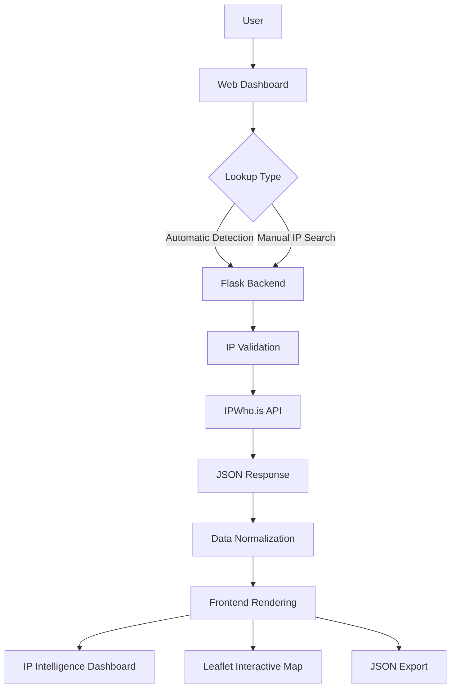

# 🌐 IP-Address-Inlligence — Network Intelligence & Geolocation Platform

<p align="center">
  <strong>Discover. Analyze. Visualize.</strong>
</p>

<p align="center">
  A lightweight IP intelligence web application that retrieves public IP information, identifies approximate geographical locations, and visualizes network data through an interactive map.
</p>

<p align="center">
  
  
  
  
</p>

---

## 📌 Overview

Every device connected to the internet communicates through an IP address. But what information can an IP address reveal?

**IP Finder** is a Python-powered web application designed to make public IP intelligence accessible through a clean, interactive dashboard.

Users can automatically detect their public IP address or manually search for an IPv4 or IPv6 address to retrieve associated network and geolocation information.

The application transforms raw API responses into structured information, making IP exploration simple and intuitive.

## ✨ Key Features

| Feature | Description |
|---|---|
| 🌍 Automatic IP Detection | Detects the visitor's public IP address |
| 🔎 IP Address Lookup | Search for public IPv4 and IPv6 addresses |
| 📍 Geolocation | Retrieves approximate city, region and country |
| 🏢 ISP Identification | Displays Internet Service Provider information |
| 🔗 ASN Information | Retrieves Autonomous System Number details |
| 🕒 Timezone Detection | Displays timezone and UTC offset |
| 🗺️ Interactive Map | Visualizes approximate IP coordinates |
| 📋 Copy IP | Copies the retrieved IP address |
| 📥 JSON Export | Downloads the lookup results as a JSON file |
| 🛡️ Input Validation | Rejects invalid and non-public IP addresses |

## 🖥️ Application Preview

> Add your actual application screenshots here after capturing them.

```text
docs/
└── screenshots/
    ├── dashboard.png
    ├── ip-lookup.png
    └── geolocation-map.png
```

Once uploaded, you can embed a screenshot like this:

```markdown

```

## ⚙️ Technology Stack

### Backend
- **Python** — Core application logic and IP address validation.
- **Flask** — Lightweight web framework and REST API endpoints.
- **Requests** — HTTP communication with the geolocation API.
- **ipaddress** — IPv4/IPv6 parsing and public IP validation.

### Frontend
- **HTML5** — Application structure.
- **CSS3** — Responsive dark-themed user interface.
- **JavaScript** — Dynamic data rendering and frontend interactions.

### External Services & Libraries
- **IPWho.is API** — IP geolocation and network information.
- **Leaflet.js** — Interactive map rendering.
- **OpenStreetMap** — Map tile data.

## 🏗️ Project Architecture

The application follows a lightweight client-server architecture.



### How It Works

1. The user opens the web application.
2. The frontend sends a request to the Flask backend.
3. The backend validates the requested IP address.
4. A request is sent to the IPWho.is geolocation API.
5. The API returns structured JSON information.
6. Python normalizes the response into a consistent data format.
7. JavaScript dynamically displays the retrieved information.
8. Leaflet visualizes the approximate geographical coordinates.

## 📂 Project Structure

```text
IPAddressFinder/
│
├── app.py
├── requirements.txt
├── README.md
├── .gitignore
│
├── templates/
│   └── index.html
│
├── static/
│   ├── css/
│   │   └── style.css
│   │
│   └── js/
│       └── app.js
│
└── venv/
```

## 🚀 Getting Started

Follow these instructions to run the project locally.

### 1. Clone the Repository

```bash
git clone https://github.com/mandrita16/IP-Address-Inlligence.git
```

```bash
cd IP-Address-Inlligence
```

### 2. Create a Virtual Environment

```bash
python -m venv venv
```

### 3. Activate the Environment

**Windows PowerShell:**

```powershell
.\venv\Scripts\Activate.ps1
```

**Windows Command Prompt:**

```cmd
venv\Scripts\activate.bat
```

**Linux / macOS:**

```bash
source venv/bin/activate
```

### 4. Install Dependencies

```bash
pip install -r requirements.txt
```

### 5. Start the Application

```bash
python app.py
```

### 6. Open in Your Browser

```text
http://127.0.0.1:5000
```

The application is now ready to use.


## 🔌 API Endpoints

The Flask backend exposes the following endpoints:

| Method | Endpoint | Description |
|---|---|---|
| GET | `/` | Serves the web dashboard |
| GET | `/api/my-ip` | Detects and retrieves the visitor's public IP information |
| GET | `/api/lookup?ip=8.8.8.8` | Retrieves information for a specified public IP |

### Example Request

```http
GET /api/lookup?ip=8.8.8.8
```

### Example Response

```json
{
    "ip": "8.8.8.8",
    "version": "IPV4",
    "city": "Mountain View",
    "region": "California",
    "country_name": "United States",
    "continent_code": "NA",
    "postal": "94035",
    "org": "Google LLC",
    "asn": "AS15169",
    "timezone": "America/Los_Angeles",
    "utc_offset": "UTC-07:00",
    "latitude": 37.386,
    "longitude": -122.0838
}
```

*Example values are illustrative; actual API responses may differ.*

## 🔍 Supported IP Address Types

**IPv4**

```text
8.8.8.8
1.1.1.1
```

**IPv6**

```text
2001:4860:4860::8888
2606:4700:4700::1111
```

The application validates addresses using Python's built-in `ipaddress` module and accepts globally routable public addresses for manual lookup.

## 🔐 Privacy & Limitations

- IP geolocation provides approximate geographical information, not an exact residential address.
- Results may vary depending on the IP provider, VPN, proxy, ISP routing, and geolocation database.
- Private, reserved, loopback and other non-global IP addresses are rejected by the manual lookup endpoint.
- IP information is retrieved through the external IPWho.is API.
- The application does not intentionally store lookup history.
- External API availability and usage restrictions may affect lookup functionality.

## 🛠️ Future Enhancements

Potential improvements planned for future versions:

-  Lookup history with local storage.
-  Dark/light theme switching.
-  Network provider and ASN visualization.
-  IP reputation and threat intelligence integration.
-  Bulk IP address lookup.
-  Domain-to-IP resolution.
-  Docker-based deployment.
-  Cloud deployment with production-grade configuration.

## 🎯 Learning Outcomes

This project demonstrates practical implementation of:

- Python backend development using Flask.
- REST API integration and JSON processing.
- IPv4 and IPv6 address validation.
- HTTP request handling and exception management.
- Frontend-backend communication using JavaScript Fetch API.
- Interactive geospatial visualization.
- Responsive web application development.

## 👩‍💻 Author

**Mandrita Dasgupta**

B.Tech — Computer Science & Engineering

Heritage Institute of Technology

<p>
  <a href="https://github.com/mandrita16">GitHub</a> ·
  <a href="https://www.linkedin.com/in/mandrita-dasgupta-00a8a428b/">LinkedIn</a>
</p>

---

<p align="center">
  <strong>Built with Python, Flask & curiosity. 🚀</strong>
</p>
